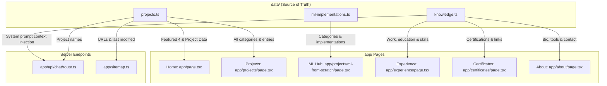
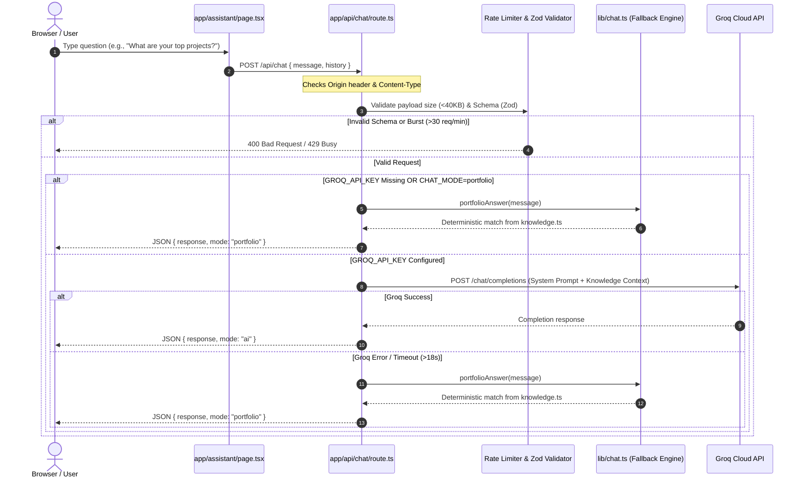
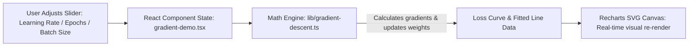

# Rudrapratap Sarma — Portfolio & Interactive ML Platform

[](https://rudrapratap-sarma.vercel.app/)
[](https://nextjs.org/)
[](https://www.typescriptlang.org/)
[](https://tailwindcss.com/)
[](LICENSE)

> **Live Website:** [https://rudrapratap-sarma.vercel.app/](https://rudrapratap-sarma.vercel.app/)

A modern, responsive portfolio and interactive machine learning learning hub built with **Next.js (App Router)**, **React 18**, **TypeScript**, **Tailwind CSS**, **Framer Motion**, **Three.js / React Three Fiber**, and **Recharts**.

The portfolio showcases end-to-end work across **Data Analytics**, **Business Intelligence**, and **AI / Machine Learning**, including an in-browser algorithm simulator and a secured, dual-mode portfolio assistant powered by the **Groq API**.

---

## 📖 Short Description & Intended Use

### What It Does
This web application is a dual-purpose personal platform:
1. **Interactive Showcase & Demonstration Hub:** Features detailed case studies and live interactive demonstrations across Data Analytics (Power BI dashboards, PostgreSQL analytics pipelines, exploratory analyses) and Machine Learning (implementations of regression and gradient descent algorithms running purely in the browser with real-time parameter tuning).
2. **AI-Powered Portfolio Assistant:** Provides recruiters and visitors with an intelligent conversational assistant that answers questions exclusively from verified portfolio facts, experience, skills, and certifications, featuring both LLM-driven mode and zero-dependency deterministic fallback mode.
3. **Dual Tailored Career Resumes:** Allows visitors to view and download role-tailored resumes targeting either **Data Analytics / BI** or **AI / Machine Learning** tracks.

### Intended Use
- **Target Audience:** Technical recruiters, engineering hiring managers, data science leaders, and collaborators looking to assess Rudrapratap Sarma's hands-on abilities in data analysis, SQL, Python, machine learning fundamentals, and AI development.
- **Goal:** Serve as the definitive professional profile and living proof-of-work for landing internships and junior engineering roles in Data Analytics and AI/ML.

---

## 🌟 Key Features

- **Selected Projects & Filterable Catalog:**
  - Dynamic filtering across Data Analytics, Data Analysis, Excel Analysis, ML Projects, and Pure Python Projects.
  - Interactive project previews, direct repository links, and live application links.
- **ML From Scratch Interactive Hub (`/projects/ml-from-scratch`):**
  - In-browser interactive machine learning demonstrations with reproducible synthetic datasets:
    - **Closed-Form Solution** (Normal equation / Ordinary Least Squares).
    - **Batch Gradient Descent** (Live hyperparameter tuning: learning rate, epochs, dynamic loss curve & regression fit line).
    - **Stochastic Gradient Descent (SGD)** (Step-by-step updates with sample-wise variance).
    - **Mini-Batch Gradient Descent** (Batch size comparison and convergence behavior).
- **Dual-Mode AI Portfolio Assistant (`/assistant` & `/api/chat`):**
  - **AI Mode:** Powered by Groq (`openai/gpt-oss-20b` or custom models via `GROQ_MODEL`) with strict prompt grounding using portfolio knowledge.
  - **Offline Fallback Mode:** Zero-dependency keyword match engine (`lib/chat.ts`) that guarantees verified answers even without an API key or when network limits are reached.
  - **Hardened Security:** Server-side API key isolation, CORS origin verification, bounded rate-limiting (30 req/min), body size caps (40 KB), input sanitization with **Zod**, and strict role restriction.
- **Dual Tailored Resumes:**
  - Automated PDF resume generation via Python (`scripts/build_resumes.py` with ReportLab) targeting **AI/ML** and **Data Analytics** roles.
- **Contact & Inquiries:**
  - Integrated Web3Forms contact form with client-side validation, error recovery, and direct mailto fallbacks.
- **Visual Polish & Ergonomics:**
  - Dark / Light / System theme toggling via `next-themes`.
  - Ambient 3D particle background and canvas scenes powered by Three.js & Fiber.
  - SEO-optimized metadata, sitemap generator (`app/sitemap.ts`), and `robots.txt`.

---

## 🏗️ Architecture & Project Structure

```text
webportfolio2/
├── app/                                 # Next.js App Router (Pages, Layouts & API)
│   ├── api/chat/route.ts                # Edge/Node.js API endpoint for Portfolio Assistant
│   ├── about/page.tsx                   # Bio, background, education, and skills
│   ├── assistant/page.tsx               # Interactive chat assistant UI
│   ├── certificates/page.tsx            # Verified certifications and credentials
│   ├── contact/page.tsx                 # Contact form & direct links
│   ├── experience/page.tsx              # Work, internships, and training timeline
│   ├── projects/                        # Projects directory
│   │   ├── page.tsx                     # Filterable project catalog
│   │   └── ml-from-scratch/             # Machine Learning interactive case studies
│   │       ├── page.tsx                 # ML Algorithms Hub
│   │       ├── closed-form/page.tsx     # OLS Normal Equation Demo
│   │       ├── gradient-descent/page.tsx# Batch Gradient Descent Demo
│   │       ├── stochastic-gradient-descent/page.tsx
│   │       └── mini-batch-gradient-descent/page.tsx
│   ├── globals.css                      # Global design system & theme variables
│   ├── layout.tsx                       # Root layout & providers
│   ├── page.tsx                         # Homepage (Hero, proof strip, top 4 projects)
│   ├── robots.ts                        # Crawler instructions
│   └── sitemap.ts                       # Dynamic XML sitemap generator
│
├── components/                          # UI Components & Modules
│   ├── 3d/hero-scene.tsx                # Three.js 3D canvas scene
│   ├── ui/                              # Shadcn/ui atomic components (Radix primitives)
│   ├── gradient-demo.tsx                # Interactive gradient descent charts & controls
│   ├── closed-form-demo.tsx             # Interactive closed-form solver & visualizer
│   ├── layout.tsx                       # Header, navigation, and footer shell
│   ├── navbar.tsx                       # Responsive navigation with mobile drawer
│   ├── portfolio.tsx                    # Shared page containers, cards, and CTA sections
│   ├── project-cards.tsx                # Filterable grid and project modal renderer
│   ├── resume-options.tsx               # Dual resume download dropdown
│   ├── search-sort.tsx                  # Search query & category sorting controls
│   └── theme-provider.tsx               # Next-themes wrapper
│
├── data/                                # Central Single-Source-of-Truth Content
│   ├── knowledge.ts                     # Grounded facts: bio, skills, education, experience, FAQs
│   ├── ml-implementations.ts            # Algorithm registry, categories, GitHub repos, and links
│   └── projects.ts                      # Full project catalog, tags, metrics, and screenshots
│
├── lib/                                 # Core Business Logic & Algorithms
│   ├── chat.ts                          # Chat validation schema & local deterministic fallback logic
│   ├── gradient-descent.ts              # Pure math implementations of regression & gradient descent
│   └── utils.ts                         # Class merging helper (clsx + tailwind-merge)
│
├── public/                              # Static public assets
│   ├── projects/                        # High-resolution project previews & screenshots
│   ├── Rudrapratap_Sarma_AI_ML_Resume.pdf
│   ├── Rudrapratap_Sarma_Data_Analytics_Resume.pdf
│   └── resume.pdf                       # Default portfolio resume download
│
├── scripts/                             # Utility & Build Tooling
│   └── build_resumes.py                 # Python script to compile PDF resumes with ReportLab
│
├── tests/                               # Automated Test Suites
│   ├── chat.test.cjs                    # Chat API security, rate limit & fallback tests
│   └── gradient-descent.test.cjs        # Mathematical convergence & gradient descent tests
│
├── .env.example                         # Environment template
├── .gitignore                           # Git ignore rules (configured for security)
├── components.json                      # Shadcn/ui configuration
├── MAINTENANCE.md                       # Comprehensive guide for updating portfolio content
├── netlify.toml                         # Netlify Next.js adapter deployment configuration
├── next.config.js                       # Next.js runtime configuration
├── package.json                         # Node dependencies & run scripts
└── tsconfig.json                        # TypeScript compiler options
```

---

## 🔄 End-to-End Data Flow

The portfolio connects data sources, user interactions, and external APIs through clearly segregated channels:

### 1. Portfolio Content Flow (Single Source of Truth)


### 2. Assistant Request & AI Data Flow


### 3. Interactive Machine Learning Execution Flow


---

## 🔒 Security & Privacy Practices

### Git & Sensitive File Hygiene (`.gitignore`)
The project enforces strict repository privacy to prevent private metadata, tokens, or temporary files from leaking:
- **Environment Variables:** `.env`, `.env*.local`, `.env.local` are explicitly ignored.
- **External Web Tool Artifacts:** `.bolt/` metadata and prompt caches are ignored and excluded from source control.
- **Build & Compilation Outputs:** `.next/`, `out/`, `build/`, `*.tsbuildinfo`, and temporary Python artifacts (`output/`, `tmp/`, `__pycache__/`) are excluded.
- **Client-Side vs Server-Side Secrets:**
  - `GROQ_API_KEY`: Server-only secret accessed in `app/api/chat/route.ts`. Never prefixed with `NEXT_PUBLIC_`.
  - `NEXT_PUBLIC_WEB3FORMS_ACCESS_KEY`: Public-safe form dispatch key used in the contact form.

---

## 🛠️ Local Development & Setup

### Prerequisites
- **Node.js**: Version `22.x` or `24.x`
- **npm** (or pnpm / yarn)
- **Python 3.10+** (Optional, required only if recompiling PDF resumes via `scripts/build_resumes.py`)

### Installation & Run

1. **Clone the repository:**
   ```bash
   git clone https://github.com/rudrapratap601/webportfolio2.git
   cd webportfolio2
   ```

2. **Install dependencies:**
   ```bash
   npm ci
   ```

3. **Configure Environment Variables:**
   Copy `.env.example` to `.env.local`:
   ```bash
   cp .env.example .env.local
   ```
   Configure the following variables in `.env.local`:
   ```env
   # Required for AI Portfolio Assistant (leave blank to use the deterministic offline fallback)
   GROQ_API_KEY=your_groq_api_key_here

   # Optional: customize Groq model (defaults to openai/gpt-oss-20b)
   GROQ_MODEL=openai/gpt-oss-20b

   # Optional: Set to 'portfolio' to force deterministic mode during local testing
   CHAT_MODE=

   # Web3Forms access key for the contact form
   NEXT_PUBLIC_WEB3FORMS_ACCESS_KEY=your_web3forms_key_here

   # Production canonical URL for metadata and sitemap generation
   SITE_URL=https://rudrapratap-sarma.vercel.app
   ```

4. **Start the local development server:**
   ```bash
   npm run dev
   ```
   Open [http://localhost:3000](http://localhost:3000) in your browser.

---

## 🧪 Testing & Validation

The codebase includes test suites for mathematical algorithms and server API safeguards:

```bash
# Typecheck TypeScript files
npm run typecheck

# Lint with ESLint
npm run lint

# Run Node.js native test runner on algorithm & chat tests
npm test

# Build for production
npm run build

# Start production build locally
npm start
```

---

## 🚀 Deployment

### Deploy to Vercel (Recommended)
1. Import the repository in [Vercel](https://vercel.com).
2. Set Framework Preset to **Next.js**.
3. Add environment variables: `GROQ_API_KEY`, `SITE_URL`, and `NEXT_PUBLIC_WEB3FORMS_ACCESS_KEY`.
4. Deploy.

### Deploy to Netlify
1. Connect repository on [Netlify](https://netlify.com).
2. The project contains a pre-configured [netlify.toml](netlify.toml) utilizing `@netlify/plugin-nextjs`.
3. Set environment variables in the Netlify site settings.
4. Deploy using standard Next.js server runtime (do not use static export, as the assistant requires server functions).

---

## 📝 Updating Content & Maintenance

For details on how to add new projects, register new ML algorithm case studies, update certifications, or rebuild resumes, please refer to [MAINTENANCE.md](MAINTENANCE.md).

---

## 📄 License & Ownership

Copyright © 2026 **Rudrapratap Sarma**. All rights reserved.

The source code of this portfolio application is released under the [MIT License](LICENSE). 

> **Important Notice on Ownership & Identity:**  
> All personal assets, photographs, downloadable resumes, educational & professional credentials, personal bio, and original project descriptions belong exclusively to **Rudrapratap Sarma**. Reusing, cloning, or redistributing this personal information, identity, or credentials under someone else's name is strictly prohibited.
